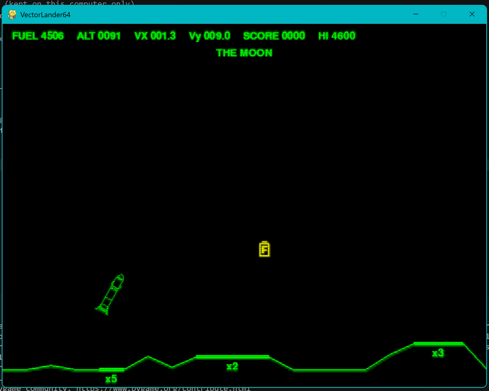

# Vector Lander

80's style retro rocket lander game!

made with pygame and deployed in github using async

---

## Play it

https://rabidkoala25.github.io/VectorLander64/ 



## Controls

| Key | What it does |
| --- | --- |
| ← → | Turn |
| ↑ | Fire the engine |
| Space | Next round |
| Esc | Quit |

## Features

- Three moons! experience the barren landscape of the moon, the heavy gravity or mars, or the howling winds of titan!
- for each flip you do, you get more points! be careful, entertainment should be second to a good landing!
- collect fuel canisters so you can execute the sick flip you definitely don't have fuel for!
- see a ghostly apparition of your former self, following your own doomed path!
- Challenge yeself with multiple difficulty pads, each smaller than the next!
- Experience the awfully grating sound of the engines, as well as explosions, retru scanlines, and more!

## How it works

the lander is a list of lines that get rotated, gravity and thrust change the speed every frame, the terrain is a random walk with flattened pads, touchdown checks speed, tilt and both feet on one pad. pretty simple really.

## Run it on your computer

```
pip install pygame
python main.py
```

## Inspiration

Atari's Lunar Lander (1979)
